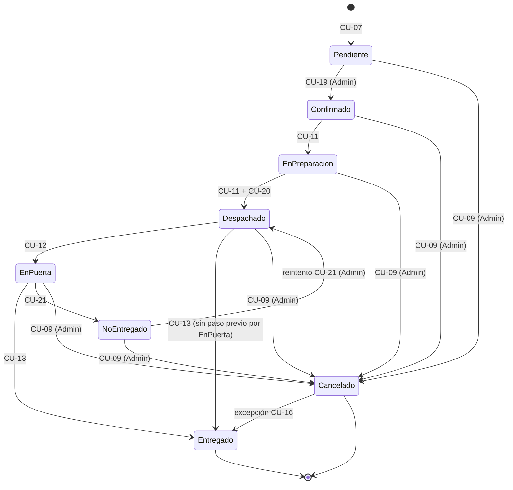

# Casos de Uso de MercuryGO

Sistema de logística y distribución B2B.
Frontend: `MercuryGo.App` (Ionic / Vue 3 / Capacitor). Backend: `MercuryGo.Api` (ASP.NET Core / EF Core).

> **Convención de este documento**
> Cada caso de uso indica su **estado real** contra el código:
> ✅ implementado · 🟡 parcial o con desvíos · 🔴 no implementado.
> Los nombres de endpoints y stores son los **reales** del repositorio, no los deseados.
> Las brechas y su severidad están en `docs/AUDITORIA_CASOS_DE_USO.md`.

---

## 1. Roles

| Rol | Código | Qué hace | Pantallas |
| :--- | :--- | :--- | :--- |
| Administrador | `ADMIN` | Gestiona catálogo, clientes, usuarios, pedidos y auditoría de pagos | Todas |
| Operario | `OPERARIO` | Prepara y despacha pedidos (picking) | Inicio, Catálogo (solo lectura), Pedidos, Mi Cuenta |
| Chofer | `CHOFER` | Entrega, registra llegada y cobra | Inicio, Pedidos, Mi Cuenta |
| Cliente | `CLIENTE` | Ve catálogo, pide, paga y consulta su cuenta | Inicio, Catálogo, Pedidos, Mi Cuenta |

---

## 2. Reglas transversales

Aplican a todos los casos de uso, por eso no se repiten en cada uno.

- **Acceso por rol (RBAC):** el router (`router.beforeEach` + `config/navegacion.js`) oculta pantallas según rol; la API lo exige con `[Authorize(Roles = RolCodigos.X)]` o con la matriz de `PedidoTransicionService`.
- **Imágenes con respaldo:** si una imagen de producto falla, `useImagenFallback.js` muestra la alternativa local.
- **Idempotencia:** los endpoints de escritura aceptan `Idempotency-Key`; el cliente que la omite se expone a duplicados.
- **Campos estructurados, no etiquetas:** los resultados de picking, cobro y comprobante van a columnas propias. **Estado: 🟡** — todavía se escriben etiquetas en `Observaciones` en varios flujos.
- **Hora real del evento:** los endpoints de estado y cobro aceptan `ocurrido_en`. **Estado: 🟡** — la API lo soporta, el cliente no lo envía.

---

## 3. Casos de uso

### Acceso

**CU-01 Iniciar sesión** — Todos · 🟡
- Ingresa con correo y contraseña, o con huella/FaceID si ya inició sesión antes en el dispositivo.
- Front: `login_page.vue`, `sesion_store.entrar()`, `token_service.js`, `biometria_service.js`.
- API: `POST /api/sesion/login` (emite JWT con usuario y rol), `POST /api/sesion/refresh` y `GET /api/sesion/yo` (perfil con `cliente_id`).
- Reglas: solo usuarios activos; mensaje genérico ante credenciales inválidas. Tokens en almacenamiento seguro (Keychain/Keystore). El `cliente_id` se resuelve por email del usuario contra `Cliente.Email`.
- **Brecha:** no hay rate limiting ni lockout en el login.

**CU-02 Cerrar sesión** — Todos · ✅
- Borra tokens locales, resetea stores, vacía el carrito, descarta la cola offline y vuelve a `/login`.
- Front: `cuenta_page.vue`, `sesion_store.salir()` → `limpiar()`. API: `POST /api/sesion/logout`.
- Reglas: el carrito pertenece al usuario, no al dispositivo: se vacía siempre y se descarta si cambia el cliente. La cola offline pendiente también se descarta (Decisión 20).

### Catálogo

**CU-03 Explorar catálogo y buscar productos** — `ADMIN`, `CLIENTE`, `OPERARIO` (solo lectura) · 🟡
- Lista paginada con filtro por categoría, búsqueda por texto (con debounce) y filtros de disponibilidad y oferta.
- Front: `productos_page.vue`, `productos_store.js`, `useImagenFallback.js`.
- API: `GET /api/productos/resumen` (categorías + destacados) y `GET /api/productos/listado?busqueda&categoria_id&disponible&en_oferta&pagina&tamano`. Solo productos activos.
- **Brecha:** el escaneo de código de barras **no** está en el catálogo; solo existe para remitos en `pedidos_page`.

**CU-04 Gestionar productos** — `ADMIN` · ✅
- Alta y edición con precio y foto (cámara o galería).
- Front: `comp_producto_modal.vue`, `useFotoProducto.js`, `camara_service.js`.
- API: `POST /api/productos`, `PUT /api/productos/{id}`, `DELETE /api/productos/{id}`, `POST /api/productos/{id}/imagen`.
- **Pendiente:** stock mínimo y stock actual (requiere migración, Decisión D2).

### Clientes

**CU-05 Gestionar clientes** — `ADMIN` · 🟡
- Alta y edición: razón social, CUIT, teléfono, email, dirección y localidad.
- Front: `clientes_page.vue`, `comp_cliente_modal.vue`, `clientes_store.js`.
- API: `GET/POST /api/clientes`, `GET/PUT/DELETE /api/clientes/{id}`. Valida CUIT y duplicados.
- **Brechas:** la API también habilita a `OPERARIO`; no existen condición de IVA ni límite de crédito en la entidad `Cliente`.

**CU-06 Consultar cuenta corriente** — `ADMIN` (todos los clientes), `CLIENTE` (solo la suya) · ✅
- Muestra saldo, pedidos pendientes de pago y comprobantes.
- Front: `comp_cuentas_corrientes_seccion.vue`, `cuenta_page.vue`.
- API: `GET /api/pedidos/cuenta-corriente` (del cliente autenticado) y `GET /api/pedidos/cuentas-corrientes-clientes` (Admin).
- Cálculo: pedidos no cancelados − cobros = saldo.
- **Pendiente:** crédito remanente (no hay límite de crédito en el modelo).

### Pedidos

**CU-07 Crear pedido** — `CLIENTE` (autoservicio), `ADMIN` (a nombre de un cliente) · 🔴
- El cliente arma el carrito desde Inicio o Catálogo. El Admin carga pedidos telefónicos con el botón `+`.
- Front: `carrito_store.js`, `comp_carrito_modal.vue`, `comp_pedido_admin_modal.vue`.
- API: `POST /api/pedidos` (`cliente_id`, `observaciones`, `items`).
- Reglas: el servidor congela precios desde la base; valida productos activos y disponibles; genera `PED-000042`; estado inicial `Pendiente`. Si un producto no está disponible, el pedido se crea igual con `ValidacionFallida = true` y su detalle.
- **Brecha:** el borrador offline no está implementado. El servidor ya resuelve el cliente desde la sesión (ignora `cliente_id` de un `CLIENTE`) y rechaza el autoservicio sin vínculo comercial.

**CU-08 Editar pedido** — `ADMIN` · ✅
- Cambia cantidades, agrega o quita productos mientras el pedido no haya iniciado el picking y siga en `Pendiente`, `Confirmado` o `EnPreparacion`. En `Despachado`, `EnPuerta` o `NoEntregado` solo se editan las observaciones.
- Front: `comp_detalle_pedido_modal.vue` (el botón depende de `observaciones_editables` y los steppers de `items_editables`).
- API: `PUT /api/pedidos/{id}` con header opcional `Idempotency-Key`.
- Reglas: se actualizan las líneas en su lugar, conservando el precio histórico y la cantidad preparada; un producto nuevo entra al precio vigente. El total no puede quedar por debajo de lo ya cobrado (`400 total_menor_a_cobrado`). Productos inválidos, duplicados o cantidades ≤ 0 se rechazan con error explícito.

**CU-09 Cancelar pedido** — `ADMIN` (cancela), `CLIENTE` (solicita) · 🟡
- Anula el pedido. El Cliente solicita y el Admin resuelve.
- Front: `comp_detalle_pedido_modal.vue`, `usePedidosWorkflow.js`.
- API: `PUT /api/pedidos/{id}/estado` → `Cancelado`; `POST /api/pedidos/{id}/solicitar-cancelacion`; `POST /api/pedidos/{id}/resolver-cancelacion`.
- Reglas: el Admin cancela en cualquier estado previo a `Entregado`, incluso en ruta. Con cobro registrado, el Admin lo ajusta con `PUT /api/pedidos/cobros/{cobroId}/ajustar`.
- **Pendiente:** devolución del stock reservado (no hay stock).

**CU-10 Generar y compartir remito PDF** — Todos · 🟡
- Descarga el remito con **código QR** y lo comparte por WhatsApp, correo, etc.
- Front: `comp_detalle_pedido_modal.vue`, `compartir_service.js`, `useEscaneoQr.js`.
- API: `GET /api/pedidos/{id}/comprobante` (PDF) y `GET /api/pedidos/{id}/qr` (imagen).

**CU-19 Confirmar pedido** — `ADMIN` · ✅
- Revisa los pedidos `Pendiente` y los confirma para que entren a preparación.
- Front: `comp_detalle_pedido_modal.vue`, `usePedidosWorkflow.js`.
- API: `POST /api/pedidos/{id}/confirmar` o `PUT /api/pedidos/{id}/estado` → `Confirmado`.
- Regla: solo el Admin confirma (Decisión 1). También puede crearse ya confirmado por el Admin.

**CU-22 Repetir pedido** — `CLIENTE` · ✅
- Desde el detalle de la orden o el historial, "Repetir pedido" carga el carrito con los mismos productos.
- Front: `comp_detalle_pedido_modal.vue`, `carrito_store.js`.

### Preparación

**CU-11 Preparar pedido (picking)** — `OPERARIO`, `ADMIN` · 🟡
- Toma un pedido confirmado (pasa a `EnPreparacion`), gestiona artículos con marcado de faltantes y confirma el picking.
- Front: `pedidos_page.vue`, `comp_picking_modal.vue`, `vibracion_service.js`.
- API: `PUT /api/pedidos/{id}/picking` con `items[{ producto_id, estado_item, cantidad_preparada }]`.
- Regla: si el picking queda incompleto, se registran faltantes y el pedido se ajusta a lo preparado.
- **Brecha:** el picking no cambia a `Despachado` (eso requiere el `PUT /estado`), y no se avisa al Admin cuando hay faltantes.

### Reparto

**CU-12 Ver ruta y marcar "En Puerta"** — `CHOFER` · ✅
- Ve solo los pedidos asignados a él (`ChoferId`) en `Despachado` y `EnPuerta`. Al llegar, toca "Marcar En Puerta" y la app guarda la ubicación GPS.
- Front: `pedidos_page.vue`, `geolocalizacion_service.js`.
- API: `PUT /api/pedidos/{id}/estado` con `{ estado: 'EnPuerta', latitud, longitud }`.

**CU-13 Cobrar y cerrar entrega (incluye Entrega Parcial)** — `CHOFER` (cierre también `ADMIN`) · ✅
- El cobro en puerta es opcional: el chofer registra monto y método (efectivo, transferencia, cheque) o deja el pedido en cuenta corriente. Si el cliente rechaza ítems, se marcan en `comp_entrega_parcial_modal.vue` y el pedido se ajusta.
- Front: `comp_cobro_chofer_modal.vue`, `comp_entrega_parcial_modal.vue`, `pedidos_page.vue`.
- API: `POST /api/pedidos/{id}/cobro-chofer`, `POST /api/pedidos/{id}/entrega-parcial`, `PUT /api/pedidos/{id}/estado` → `Entregado`.
- Reglas: solo se cobra en `Despachado`, `EnPuerta` o (Admin) `Entregado`; el acumulado no puede superar el total de la orden; se envía `Idempotency-Key` y `ocurrido_en`. Si el pedido tiene chofer asignado, solo ese chofer puede cobrarlo.
- Como el despacho exige chofer asignado (CU-20), en la práctica todo pedido en reparto tiene dueño y la validación de propiedad se aplica siempre.

**CU-20 Asignar chofer** — `OPERARIO`, `ADMIN` · ✅
- Al despachar o desde el detalle de la orden se asigna o reasigna chofer mientras el pedido no esté `Entregado` ni `Cancelado`.
- Front: `comp_detalle_pedido_modal.vue` (selector "Chofer asignado", deshabilitado sin conexión) → `pedidos_service.obtener_choferes()` / `asignar_chofer()`.
- API: `GET /api/pedidos/choferes` (solo rol `CHOFER` activos) y `PUT /api/pedidos/{id}/chofer` con `{ chofer_id }`.
- Reglas: el usuario destino debe existir, estar activo y tener rol `CHOFER` (`400 chofer_invalido`); no se puede despachar un pedido sin chofer asignado (`400 chofer_requerido`).

**CU-21 Registrar entrega fallida y reintentar** — `CHOFER`, `ADMIN` · 🟡
- Desde `EnPuerta`, el chofer registra "No entregado" con motivo, nota y foto opcional.
- Reintento: el Admin pasa el pedido de `NoEntregado` a `Despachado`.
- Front: `comp_entrega_fallida_modal.vue`, `usePedidosWorkflow.js`.
- API: `POST /api/pedidos/{id}/no-entregado`, `POST /api/pedidos/{id}/reintentar-entrega`.
- **Brecha:** falta `Despachado → NoEntregado`; el reintento es solo Admin, pero la UI lo ofrece al Chofer.

**CU-23 Prueba de entrega** — `CHOFER` · 🟡
- Al entregar, coordenadas GPS y, en entrega parcial, foto y/o firma opcionales, con fecha y hora del evento.
- Retención: fotos y firmas se purgan a los 2 meses por `RetencionArchivosService` (Decisión 21).
- **Brecha:** la entrega directa no captura foto ni firma; solo la entrega parcial las persiste.

### Pagos

**CU-14 Subir comprobante de pago** — `CLIENTE`, `ADMIN` · ✅
- Fotografía o adjunta el comprobante de transferencia. Queda pendiente de auditoría.
- Front: `comp_comprobante_modal.vue`, `camara_service.js`.
- API: `POST /api/pedidos/{id}/comprobante-pago` (multipart).

**CU-15 Auditar comprobante** — `ADMIN` · ✅
- Revisa la imagen y aprueba o rechaza. Al aprobar, impacta el saldo del cliente.
- Front: `comp_detalle_pedido_modal.vue`, `comp_cuentas_corrientes_seccion.vue`.
- API: `PUT /api/pedidos/{id}/aprobar-comprobante`, `PUT /api/pedidos/{id}/rechazar-comprobante`.

### Modo sin conexión

**CU-16 Trabajar sin conexión y sincronizar** — Todos (clave para `CHOFER` y `OPERARIO`) · 🔴
- Sin internet, la app muestra los datos guardados y un banner amarillo. Los cambios de estado se encolan con el badge "Sin enviar" y se envían solos al volver la conexión.
- Front: `offline_store.js` (`encolar_accion`, `sincronizar`), `copia_local_service.js`, `@capacitor/network`.
- Reglas de conflicto: si el Admin canceló mientras tanto, gana la acción del chofer; si el pedido fue reasignado, también gana el chofer; si el Operario hizo picking de un pedido cancelado, se guarda el picking y el pedido sigue `Cancelado`. En todos los casos se avisa al Admin.
- Cola: las acciones enviadas se conservan hasta cerrar sesión.
- **Brechas:** `CREAR_PEDIDO` está soportado en la sincronización pero nunca se encola; `ocurrido_en` no se envía; los avisos al Admin no existen.

### Usuarios y cuenta

**CU-17 Administrar personal** — `ADMIN` · 🟡
- Alta de usuarios, asignación de rol y baja.
- Front: `usuarios_page.vue`, `comp_usuario_modal.vue`, `usuarios_store.js`.
- API: `GET/POST /api/usuarios`, `PUT /api/usuarios/{id}/rol`, `DELETE /api/usuarios/{id}`.
- **Brecha:** no existe reseteo de contraseña (`PUT /api/usuarios/{id}/password`).

**CU-18 Ver mi cuenta** — Todos · ✅
- Muestra datos personales, rol, estado de conexión y métricas (cliente: saldo y pendientes; personal: pedidos gestionados).
- Front: `cuenta_page.vue` (refresca en `onIonViewWillEnter`).

---

## 4. Estados del pedido

| Transición | Quién (API real) | Caso de uso | Estado |
| :--- | :--- | :--- | :--- |
| → Pendiente | Cliente / Admin / Operario | CU-07 | ✅ |
| Pendiente → Confirmado | Admin | CU-19 | ✅ |
| Confirmado → EnPreparacion | Operario / Admin | CU-11 | ✅ |
| EnPreparacion → Despachado | Operario / Admin | CU-11 + CU-20 | ✅ (exige chofer asignado) |
| Despachado → EnPuerta | Chofer / Admin | CU-12 | ✅ |
| Despachado → Entregado | Chofer / Admin | CU-13 | ✅ |
| EnPuerta → Entregado | Chofer / Admin | CU-13 | ✅ |
| EnPuerta → NoEntregado | Chofer / Admin | CU-21 | ✅ |
| Despachado → NoEntregado | Chofer / Admin | CU-21 | 🔴 falta |
| NoEntregado → Despachado | Admin | CU-21 | ✅ (solo Admin) |
| → Cancelado (hasta antes de Entregado) | Admin; el Cliente solo solicita | CU-09 | ✅ |
| Cancelado → Entregado | Chofer / Admin, solo por sincronización offline | CU-16 | ✅ |

**Nota:** `Pendiente`, `Confirmado`, `EnPreparacion`, `Despachado` y `EnPuerta` no admiten auto-transición; repetir el mismo estado responde éxito sin efectos (idempotencia por estado).

---

## 5. Plugins de Capacitor

| Plugin | Wrapper | Casos de uso |
| :--- | :--- | :--- |
| `@capacitor/camera` | `camara_service.js`, `useFotoProducto.js` | CU-04, CU-14, CU-23 |
| `@capacitor-mlkit/barcode-scanning` | `qr_service.js`, `useEscaneoQr.js` | CU-10 (escaneo de remitos) |
| `@capacitor/geolocation` | `geolocalizacion_service.js` | CU-12, CU-23 |
| `@capacitor/haptics` | `vibracion_service.js` | CU-07, CU-11, CU-16 |
| `@capacitor/share` | `compartir_service.js` | CU-10 |
| `@capacitor/network` | `offline_store.js` | CU-16 |
| Almacenamiento seguro (Keychain/Keystore) | `token_service.js`, `biometria_service.js` | CU-01, CU-02 |
| `@capacitor/preferences` | `copia_local_service.js` | CU-16 (solo datos no sensibles) |
| `@aparajita/capacitor-biometric-auth` | `biometria_service.js` | CU-01 |

---

## 6. Decisiones cerradas

| # | Tema | Decisión | Estado |
| :--- | :--- | :--- | :--- |
| 1 | Confirmar pedido | Lo hace el Admin a mano (CU-19) | ✅ |
| 2 | Despachar | Lo marca el Operario al terminar el picking | 🟡 el picking no despacha solo |
| 3 | Cancelación del Admin | Hasta antes de `Entregado`, incluso en ruta | ✅ |
| 4 | Cancelar con cobro ya registrado | El Admin ajusta el cobro a mano | 🟡 existe el endpoint, sin UI |
| 5 | Picking incompleto | Despacha igual y ajusta el pedido a lo preparado | 🟡 ajusta, no despacha |
| 6 | Operario y Catálogo | Catálogo habilitado en solo lectura | ✅ |
| 7 | Aviso al cliente por ajuste | Solo lo ve en el detalle del pedido | ✅ |
| 8 | Cobro en puerta | Siempre opcional; puede quedar en cuenta corriente | ✅ |
| 9 | Picking, cobro y comprobante | Campos propios en la base de datos | 🟡 quedan etiquetas en `Observaciones` |
| 10 | Conflicto offline vs. cancelación | Gana la acción del chofer | 🟡 transición permitida, sin aviso al Admin |
| 11 | Tokens | Almacenamiento seguro (Keychain/Keystore) | ✅ |
| 12 | Cancelación del Cliente | Solicita y el Admin aprueba | ✅ |
| 13 | CU-20 a CU-23 y estado `NoEntregado` | Aprobados | ✅ CU-20 con UI y API |
| 14 | Ítems rechazados en la puerta | El chofer los marca y el pedido se ajusta | ✅ |
| 15 | Prueba de entrega | Foto y firma siempre opcionales | 🟡 solo en entrega parcial |
| 16 | Picking offline sobre pedido cancelado | Se guarda el picking; el pedido sigue `Cancelado` | 🔴 la API lo bloquea |
| 17 | Entrega offline de pedido reasignado | Gana el chofer | 🔴 sin implementar |
| 18 | Crear pedido sin conexión | Permitido, como borrador que se valida al sincronizar | 🔴 sin implementar |
| 19 | Borrador que falla crédito o stock | Pasa a `Pendiente` igual y el Admin decide | 🟡 `ValidacionFallida`, sin crédito ni stock |
| 20 | Acciones enviadas en el dispositivo | Se conservan hasta cerrar sesión | ✅ |
| 21 | Fotos y firmas de entrega en el servidor | Se conservan 2 meses | ✅ |

---

## 7. Brechas y plan

El detalle de cada hallazgo, con evidencia `archivo:línea` y severidad, está en
`docs/AUDITORIA_CASOS_DE_USO.md`. La hoja de ruta técnica general está en
`docs/AUDITORIA_FINAL.md` (fases A–D).
