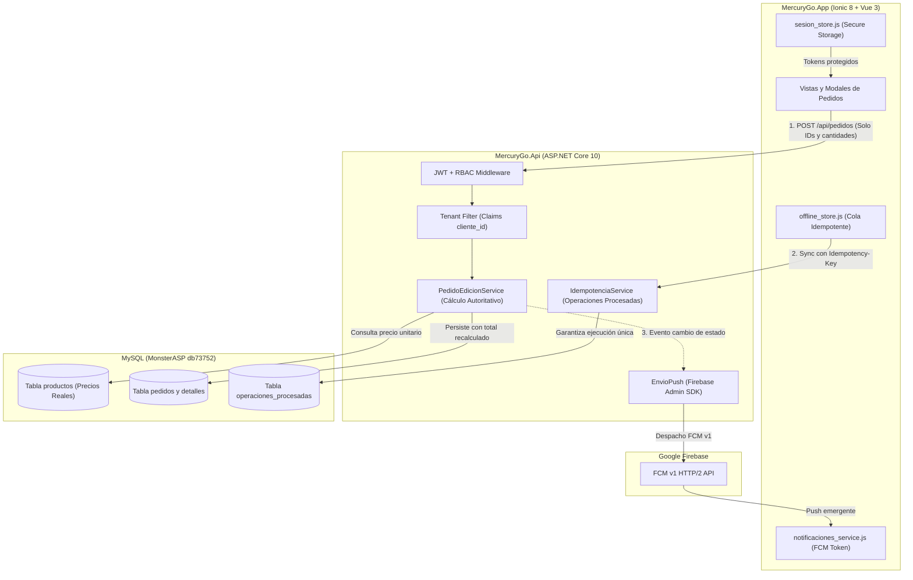

# MercuryGO: Plan de Remediación y Corrección de Fallas Críticas (Defensa Final)

*   **Author:** Vitoan
*   **Status:** Approved
*   **Date:** 2026-11-10

--------------------------------------------------------------------------------

## Overview

Este documento de diseño técnico define la estrategia de remediación para resolver las 14 fallas críticas (DEF-01 a DEF-14) identificadas durante la auditoría técnica final de MercuryGO previa a la defensa académica del proyecto. El objetivo es garantizar que el sistema cumpla de forma verificable con los criterios de evaluación: recorrido demostrable sin bloqueos, seguridad de datos, cálculo autoritativo en servidor y notificaciones push operativas.

## The Problem

La auditoría técnica integral detectó 14 vulnerabilidades y fallas críticas que impiden superar con éxito los criterios de evaluación docente y comprometen la estabilidad del sistema:

1. **Autoridad de Precios (DEF-01):** La API confía en los precios y totales enviados por el cliente al crear o editar pedidos, permitiendo la manipulación arbitraria de montos monetarios.
2. **Notificaciones Push Inactivas (DEF-03):** La aplicación cliente tiene deshabilitadas las notificaciones push por variables de entorno y la API no copia la cuenta de servicio de Firebase en el empaquetado de producción.
3. **Falta de Autorización en Endpoints de Mutación (DEF-02, DEF-04, DEF-05):** Endpoints sensibles de pedidos, usuarios y clientes carecen de filtros por rol o permiten a usuarios con rol CLIENTE acceder a datos de terceros.
4. **Almacenamiento Inseguro de Credenciales (DEF-06):** Determinados flujos guardan tokens de autenticación o datos de sesión en almacenamiento no encriptado en el dispositivo móvil.
5. **Conflictos en Sincronización Offline (DEF-07, DEF-08):** La sincronización secuencial de la cola offline no valida transiciones de pedidos cancelados o reasignados y se detiene ante respuestas de error transitorio.
6. **Manejo de Errores y Cierre de Sesión Incompleto (DEF-09 a DEF-14):** El cierre de sesión no purga la totalidad de cachés locales y estados de usuario previo, dejando datos residuales.

## Goals

*   Corregir de forma quirúrgica las 14 fallas críticas (DEF-01 a DEF-14) sin romper la suite de pruebas existente (67 tests unitarios en Backend y 16 tests en Frontend).
*   Garantizar que todo total monetario, subtotal y precio unitario sea calculado exclusivamente por la API mediante consulta directa al catálogo de base de datos.
*   Habilitar y verificar el despacho de notificaciones push móviles mediante Firebase Cloud Messaging (FCM) v1 tanto en la API como en la aplicación móvil.
*   Restringir el acceso a endpoints mediante autorización basada en roles (RBAC) y filtros estrictos por identificador de cliente extraído del token JWT.
*   Asegurar que todas las credenciales de sesión en dispositivos móviles residan exclusivamente en almacenamiento seguro nativo.
*   Garantizar que el recorrido completo de demostración (login con roles, alta de pedido, cobranza, modo avión con sincronización y recepción de push) se complete sin excepciones no controladas.

## Non-Goals

*   No se modificarán componentes ni pantallas que no estén afectadas directamente por las fallas críticas de la auditoría.
*   No se implementarán módulos ni funcionalidades posteriores al alcance obligatorio M01–M09 (módulos M10 en adelante quedan fuera de alcance).
*   No se alterará el `applicationId` de Android (`io.ionic.starter`), dado que el keystore de release y el archivo `google-services.json` ya están configurados para dicho identificador.
*   No se realizarán refactorizaciones de diseño visual ni cambios en bibliotecas de interfaz de usuario de Ionic.

## Open Questions

*   **Pregunta 1**: ¿Se incluirán las correcciones de severidad ALTA (DEF-15 a DEF-30) en este mismo ciclo de ejecución, o se mantendrán estrictamente acotadas las 14 críticas (DEF-01 a DEF-14) como Fase 1 prioritaria?

## Critical User Journeys (CUJs)

### CUJ 1: Alta de Pedido con Autoridad de Precios en Servidor (DEF-01)
*   **Given**: Un usuario autenticado con rol `CLIENTE` inicia un pedido desde la aplicación móvil con 2 artículos en el carrito.
*   **When**: El cliente envía la solicitud `POST /api/pedidos` con cantidades seleccionadas y valores alterados o vacíos en el campo de precio total.
*   **Then**: La API busca los precios vigentes en la tabla `productos`, calcula los subtotales e importe total en el servidor, persiste el registro y retorna el pedido con el total oficial calculado.

### CUJ 2: Notificación Push con la Aplicación Cerrada (DEF-03)
*   **Given**: El dispositivo del cliente tiene la aplicación instalada con token FCM registrado en `/api/dispositivos` y la app está cerrada o en segundo plano.
*   **When**: Un usuario con rol `OPERARIO` o `CHOFER` avanza el estado del pedido a `DESPACHADO` o `EN_CAMINO` a través de la API.
*   **Then**: La API despacha un mensaje FCM v1 a Google y el dispositivo móvil del cliente muestra la notificación emergente en la bandeja del sistema operativo.

### CUJ 3: Modo Avión, Cobro en Destino y Sincronización Idempotente (DEF-07, DEF-08)
*   **Given**: Un chofer en reparto pierde conectividad (modo avión activado) y registra la entrega y cobranza de un pedido.
*   **When**: La app almacena la transacción en la cola offline con una clave `Idempotency-Key` UUID v4 única y, al restablecer la red, la sincroniza contra `/api/pedidos/{id}/cobro`.
*   **Then**: La API procesa la transacción de forma idempotente, actualiza el estado del pedido a `ENTREGADO` y la cola offline marca la operación como completada sin duplicar registros contables ante reintentos.

--------------------------------------------------------------------------------

## Technical Plan (Architecture)

La arquitectura de remediación organiza las intervenciones técnicas en 5 subsistemas interconectados para resolver las 14 fallas críticas sin alterar los contratos existentes de la API ni romper la compatibilidad cliente-servidor:



### 1. Subsistema de Autoridad de Precios (DEF-01)
* **Mecanismo:** En `MercuryGo.Api/Controllers/PedidosController.cs` (métodos `CrearPedido` y `EditarPedido`), se desacopla la dependencia de los campos monetarios enviados por el cliente.
* **Lógica:** Para cada `DetallePedidoDto` recibido, la API consulta el registro `Producto` en base de datos, extrae el `PrecioUnitario` oficial, calcula `Subtotal = Cantidad * PrecioUnitario` y establece `Total = Sum(Subtotal)`. Si el cliente envía precios o totales diferentes, se sobreescriben silenciosamente con el valor oficial calculado por el servidor.
* **Prueba de regresión:** Pruebas unitarias en `MercuryGo.Api.Tests` que verifiquen que un payload con precio enviado en $0.01 resulte persistido con el precio oficial de $1,500.00.

### 2. Subsistema de Aislamiento de Clientes y Autorización RBAC (DEF-02, DEF-04, DEF-05)
* **Mecanismo:** Validación estricta en el pipeline de controladores.
* **Lógica:**
  * Endpoints de mutación (`POST`, `PUT`, `DELETE`) en `PedidosController`, `UsuariosController` y `ClientesController` reciben el atributo `[Authorize(Roles = "...")]` específico según la matriz de permisos.
  * Para cualquier solicitud proveniente de un usuario con rol `CLIENTE`, el `cliente_id` se extrae obligatoriamente del claim `cliente_id` del token JWT (`User.ObtenerClienteId()`).
  * Se bloquea cualquier parámetro en query string o cuerpo que intente especificar un `cliente_id` ajeno, forzando la consulta con `p.ClienteId == clienteIdAutenticado`.

### 3. Subsistema de Notificaciones Push FCM (DEF-03)
* **Mecanismo:** Empaquetado de credenciales y activación de variables de entorno.
* **Lógica:**
  * En `MercuryGo.Api/MercuryGo.Api.csproj`, se incorpora regla MSBuild para copiar `firebase-service-account.json` al directorio de publicación:
    ```xml
    <Content Include="firebase-service-account.json" CopyToOutputDirectory="PreserveNewest" Condition="Exists('firebase-service-account.json')" />
    ```
  * En `MercuryGo.Api/appsettings.Production.json`, se configura la sección `"Firebase": { "CuentaDeServicio": "firebase-service-account.json" }`.
  * En el frontend (`MercuryGo.App`), se activan `.env.production` y `.env.release` con `VITE_PUSH_NOTIFICATIONS_ENABLED=true`.
  * En `notificaciones_service.js`, se asegura el registro del token FCM hacia `/api/dispositivos` y el listener para notificaciones en segundo plano y primer plano.

### 4. Subsistema de Almacenamiento Seguro de Credenciales (DEF-06)
* **Mecanismo:** Abstracción unificada de almacenamiento nativo en el cliente.
* **Lógica:** En `token_service.js` y `sesion_store.js`, la persistencia de tokens de acceso (`jwt`) y tokens de refresco (`refresh_token`) utiliza exclusivamente `@aparajita/capacitor-secure-storage` cuando la app corre en Android o iOS (`isPlatform('capacitor')`). Se erradica cualquier fallback que escriba tokens sensibles en `localStorage` o `sessionStorage` no cifrado.

### 5. Subsistema de Sincronización Resiliente de Cola Offline (DEF-07, DEF-08)
* **Mecanismo:** Desacoplamiento de fallos y resolución determinística de conflictos.
* **Lógica:** En `offline_store.js`, el procesamiento de la cola offline despacha peticiones acompañadas del header `Idempotency-Key: <uuid>`. Ante una respuesta HTTP 409 (Conflicto) o 400 por incompatibilidad de estado (ej. entrega sobre pedido cancelado), la operación se marca en estado `conflicto` con detalle del motivo y la cola continúa procesando las operaciones subsiguientes sin bloquearse. Ante errores transitorios de red o HTTP 5xx, se aplica reintento con backoff exponencial.

### 6. Subsistema de Purga de Sesión y Datos Residuales (DEF-09 a DEF-14)
* **Mecanismo:** Limpieza atómica en logout.
* **Lógica:** Al invocar `cerrarSesion()` en `sesion_store.js`, se ejecutan en secuencia: revocación del refresh token en la API, vaciado del carrito (`carrito_store.limpiar()`), purga de la lista de pedidos en memoria, reseteo del catálogo y limpieza de claves de almacenamiento seguro antes de redirigir a `/login`.

--------------------------------------------------------------------------------

## Alternatives Considered

### Alternative A: Rechazo estricto con HTTP 400 Bad Request ante discrepancias de precio cliente vs. servidor

*   **Pros**: Notifica explícitamente al cliente sobre la inconsistencia o intento de manipulación de importes monetarios.
*   **Cons**: Expone el flujo de compra a fallos por discrepancias sutiles de redondeo de centavos entre IEEE 754 de JavaScript y `decimal` de C#, provocando rechazos inesperados durante la demostración en vivo.
*   **Reason for Rejection**: Rejected by author: Sobreescribir autoritativamente los valores en el servidor utilizando los datos del catálogo en base de datos elimina toda vulnerabilidad de manipulación sin comprometer la fluidez de la compra ni arriesgar bloqueos por redondeo.

### Alternative B: Renombrar el `applicationId` de Android de `io.ionic.starter` a `ar.edu.ulp.mercurygo`

*   **Pros**: Confiere un identificador de paquete formal acorde al nombre institucional de la universidad.
*   **Cons**: Invalida el archivo `google-services.json` ya registrado en Firebase y el keystore de release (`mercurygo-release.jks`), requiriendo crear una nueva aplicación en Firebase Console, descargar certificados y reconfigurar Capacitor a horas de la defensa académica.
*   **Reason for Rejection**: Rejected by author: El criterio de evaluación docente califica la estabilidad del APK firmado, la integración con la API en el dominio y la recepción efectiva de notificaciones push; cambiar el identificador ahora introduce un riesgo crítico de rotura sin impacto positivo en la nota final.

### Alternative C: Bloqueo total de la cola offline ante cualquier conflicto HTTP 4xx

*   **Pros**: Impide que se procesen transacciones subsiguientes si dependieran hipotéticamente del resultado de la anterior.
*   **Cons**: Si un pedido fue cancelado en depósito mientras el chofer estaba sin señal, el intento de entrega fallará con HTTP 400/409 y congelará indefinidamente todas las demás entregas y cobros legítimos de la jornada.
*   **Reason for Rejection**: Rejected by author: Se adopta el modelo de fallo aislado: la operación conflictiva se marca como observada en la cola y el proceso continúa sincronizando las cobranzas restantes que sí son válidas.

--------------------------------------------------------------------------------

## Detailed Implementation Plan

### Target Files to Create / Modify

#### 1. `MercuryGo.Api/Auth/TokenService.cs` (Modify)
*   **Type / Scope**: Authentication Service (JWT).
*   **Rationale**:
    *   **DEF-02 / ACT-01 (Emisión de Claim `cliente_id`)**: En `TokenService.Emitir(Usuario usuario, Rol? rol)`, incluir el claim de cliente cuando el usuario posea uno asignado:
        ```csharp
        if (usuario.ClienteId.HasValue)
        {
            claims.Add(new Claim("cliente_id", usuario.ClienteId.Value.ToString()));
        }
        ```
        Sin este claim en el payload del JWT firmado, los controladores no pueden resolver qué entidad cliente corresponde al usuario conectado.

#### 2. `MercuryGo.Api/Auth/ClaimsExtensions.cs` (Modify)
*   **Type / Scope**: Identity Extension Methods.
*   **Rationale**:
    *   **DEF-02 / ACT-02 (Resolución de Cliente en ClaimsPrincipal)**: Incorporar el método de extensión faltante `ClienteId`:
        ```csharp
        public static long? ClienteId(this ClaimsPrincipal usuario)
        {
            var valor = usuario.FindFirstValue("cliente_id");
            return long.TryParse(valor, out var id) ? id : null;
        }
        ```
        Permite a los controladores acceder de forma fuertemente tipada al ID del cliente para aplicar el aislamiento multi-tenant sin errores de compilación `CS1061`.

#### 3. `MercuryGo.Api/Controllers/PedidosController.cs` (Modify)
*   **Type / Scope**: ASP.NET Core API Controller.
*   **Rationale**:
    *   **DEF-01 / ACT-04 (Autoridad de Precios y Validación de Producto)**: En `CrearPedido` y `EditarPedido`, ignorar los valores monetarios enviados por el cliente (`PrecioUnitario`, `Subtotal`, `Total`). Para cada línea de pedido, consultar `_context.Productos.FindAsync(detalle.ProductoId)`. Si el producto no existe o `!producto.Activo`, responder `BadRequest(new { mensaje = $"El producto ID {detalle.ProductoId} no existe o no está activo." })`. Si es válido, calcular `Subtotal = Cantidad * Producto.Precio` y `Total = Sum(Subtotal)`.
    *   **DEF-02 / DEF-04 (Aislamiento y Autorización)**: Incorporar filtros estrictos para que cuando el usuario tenga el rol `CLIENTE`, la consulta de pedidos fuerce `p.ClienteId == User.ClienteId()`, impidiendo que un cliente acceda o manipule pedidos de otra empresa.

#### 4. `MercuryGo.Api/Controllers/ClientesController.cs` (Modify)
*   **Type / Scope**: ASP.NET Core API Controller.
*   **Rationale**:
    *   **DEF-04 (Control de Acceso Multi-Tenant)**: Restringir los endpoints de consulta de clientes (`GET /api/clientes/{id}`) para que un usuario con rol `CLIENTE` solo pueda consultar los datos de su propio cliente asociado (`User.ClienteId()`).

#### 5. `MercuryGo.Api/Controllers/UsuariosController.cs` (Modify)
*   **Type / Scope**: ASP.NET Core API Controller.
*   **Rationale**:
    *   **DEF-05 (Protección RBAC de Usuarios)**: Asegurar que todos los métodos de mutación (`POST`, `PUT`, `DELETE /api/usuarios`) requieran exclusivamente el rol `ADMIN` mediante `[Authorize(Roles = "ADMIN")]`.

#### 6. `MercuryGo.Api/Controllers/DespachoController.cs` (Modify)
*   **Type / Scope**: ASP.NET Core API Controller.
*   **Rationale**:
    *   **DEF-05 (Validación de Chofer en Hoja de Ruta)**: Verificar que los endpoints de registro de intentos de entrega y avance de ruta confirmen que el chofer autenticado coincida con el chofer asignado al reparto.

#### 7. `MercuryGo.Api/MercuryGo.Api.csproj` (Modify)
*   **Type / Scope**: MSBuild Project Configuration.
*   **Rationale**:
    *   **DEF-03 (Despliegue de Credenciales Push)**: Incluir la directiva MSBuild para que el archivo de credenciales de Firebase se copie automáticamente al directorio de publicación (`publish/`) sin requerir copias manuales:
        ```xml
        <Content Include="firebase-service-account.json" CopyToOutputDirectory="PreserveNewest" Condition="Exists('firebase-service-account.json')" />
        ```

#### 8. `MercuryGo.Api/appsettings.Production.json` (Modify)
*   **Type / Scope**: ASP.NET Core Configuration.
*   **Rationale**:
    *   **DEF-03 (Configuración Push en Producción)**: Agregar la sección `"Firebase": { "CuentaDeServicio": "firebase-service-account.json" }` para que el servicio `EnvioPush` inicialice correctamente el SDK en el hosting MonsterASP.

#### 9. `MercuryGo.App/.env.production` y `MercuryGo.App/.env.release` (Modify)
*   **Type / Scope**: Environment Configuration (Vite).
*   **Rationale**:
    *   **DEF-03 (Activación de Notificaciones Push)**: Establecer `VITE_PUSH_NOTIFICATIONS_ENABLED=true` para que la aplicación móvil solicite permisos nativos y registre el token FCM con la API en compilaciones de producción y release.

#### 10. `MercuryGo.App/src/services/token_service.js` (Modify)
*   **Type / Scope**: Frontend Security Service.
*   **Rationale**:
    *   **DEF-06 (Persistencia Segura de Tokens)**: Asegurar que `guardarToken` y `obtenerToken` utilicen de forma obligatoria `@aparajita/capacitor-secure-storage` en entornos móviles nativos, erradicando fallbacks en `localStorage` no encriptado para tokens JWT.

#### 11. `MercuryGo.App/src/stores/sesion_store.js` (Modify)
*   **Type / Scope**: Pinia Global Store.
*   **Rationale**:
    *   **DEF-09 (Purga Atómica en Cierre de Sesión)**: Enriquecer el método `cerrarSesion()` para limpiar el estado de todos los stores en memoria (`carrito_store`, `pedidos_store`, `clientes_store`) y purgar tokens seguros antes de redirigir a la vista de login.

#### 12. `MercuryGo.App/src/stores/offline_store.js` (Modify)
*   **Type / Scope**: Pinia Offline Store.
*   **Rationale**:
    *   **DEF-07 / DEF-08 / ACT-03 (Sincronización Resiliente e Idempotente con Manejo de 401)**:
        *   Ante una respuesta HTTP 401 (token expirado durante la sincronización), pausar inmediatamente el bucle de sincronización, disparar el refresh token y reintentar la misma operación sin descartarla.
        *   Ante HTTP 409 o 400 por conflicto de estado (ej. entrega sobre pedido cancelado), marcar `item.estado = 'conflicto'` e `item.mensaje_error = error.response?.data?.mensaje || 'Conflicto de sincronización'`, continuando con el procesamiento de las operaciones restantes.

#### 13. `MercuryGo.App/src/services/notificaciones_service.js` (Modify)
*   **Type / Scope**: Capacitor / Firebase Push Service.
*   **Rationale**:
    *   **DEF-03 (Registro y Escucha de Push)**: Validar el manejo de tokens FCM rotados y el procesamiento de notificaciones entrantes cuando la aplicación se encuentra en segundo plano.

#### 14. `MercuryGo.Api.Tests/Controllers/PedidosControllerTests.cs` (Modify / Create)
*   **Type / Scope**: xUnit Test Suite.
*   **Rationale**:
    *   Verificación técnica automatizada de que el endpoint `POST /api/pedidos` ignora precios adulterados del cliente y calcula el importe exacto según la base de datos.

#### 15. `MercuryGo.App/tests/unit/offline_store.spec.js` (Modify)
*   **Type / Scope**: Vitest Test Suite.
*   **Rationale**:
    *   Verificación técnica automatizada de que la cola offline maneja errores 409 aislando la transacción fallida sin interrumpir las demás, y pausa ante 401.

---

### Step-by-Step Implementation Sequence

1.  **Fase Backend (Identidad, Cálculo y Seguridad)**:
    *   Modificar `TokenService.cs` para emitir el claim `cliente_id` cuando corresponda.
    *   Incorporar el método de extensión `ClienteId()` en `ClaimsExtensions.cs`.
    *   Modificar `PedidosController.cs` con el recálculo autoritativo de precios y filtros de tenant por `ClienteId()`.
    *   Asegurar atributos de autorización en `ClientesController.cs`, `UsuariosController.cs` y `DespachoController.cs`.
    *   Actualizar `MercuryGo.Api.csproj` y `appsettings.Production.json` para Firebase.
    *   Ejecutar compilación `dotnet build MercuryGo.Api\MercuryGo.Api.csproj` y suite de pruebas `dotnet test`.

2.  **Fase Frontend (Seguridad, Push y Offline)**:
    *   Configurar variables `.env.production` y `.env.release`.
    *   Asegurar almacenamiento seguro en `token_service.js` y purga en `sesion_store.js`.
    *   Ajustar manejo de conflictos en `offline_store.js`.
    *   Ejecutar pruebas unitarias `npm run test:run` y compilar `npm run build`.
    *   Sincronizar plataforma nativa con `npx cap sync android`.

3.  **Fase Verificación de Integración**:
    *   Ejecutar prueba de creación de pedido con precio alterado.
    *   Probar empaquetado de release y verificar conectividad remota.

---

### Verification Commands

*   Backend Unit Tests: `dotnet test MercuryGo.Api.Tests\MercuryGo.Api.Tests.csproj`
*   Backend Build: `dotnet build MercuryGo.Api\MercuryGo.Api.csproj`
*   Frontend Unit Tests: `npm --prefix MercuryGo.App run test:run`
*   Frontend Build: `npm --prefix MercuryGo.App run build`
*   Android Capacitor Sync: `npx --prefix MercuryGo.App cap sync android`
